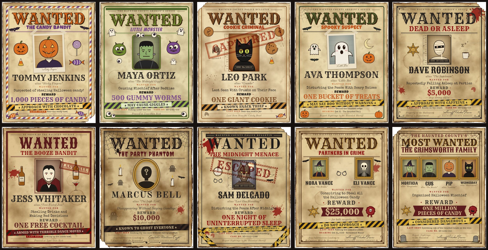
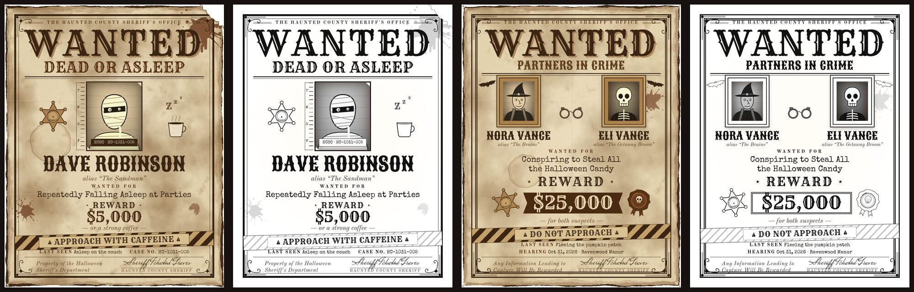

# Halloween WANTED Poster Templates

Ten vintage "WANTED" poster templates for a Halloween party, plus a browser studio for personalizing them for each guest and exporting print-ready files.



| Children's Collection | Adult Collection | Special Edition |
|---|---|---|
| 1. The Candy Bandit | 5. The Serial Snoozer ("Dead or Asleep") | 9. Partners in Crime (2 suspects) |
| 2. The Little Monster | 6. The Booze Bandit | 10. The Most Wanted Family (2–6 suspects) |
| 3. The Cookie Criminal | 7. The Party Phantom | |
| 4. The Spooky Suspect | 8. The Midnight Menace | |

**Live studio:** <https://wmcbay13.github.io/wanted_poster_templates/>. Open it in any browser; nothing to install.

## Quick start

To run the studio locally instead:

```bash
npm install          # only needed for batch rendering (puppeteer-core)
npm run serve        # then open http://localhost:8080
```

You can also open `index.html` straight from disk for editing and PDF printing. PNG export needs http(s), meaning the live site or `npm run serve`, because browsers block file access from `file://` pages.

## Creating a poster

1. **Add a guest.** Click **+ Add guest** in the left column. Use ⧉ to duplicate a guest who will share a template.
2. **Choose a template.** Click a thumbnail under *Children's Collection*, *Adult Collection* or *Special Edition*.
3. **Enter the suspect.** Type the guest's **name** and an optional **nickname / alias**. Partners in Crime takes two suspects. Most Wanted Family takes 2–6, added with **+ Add suspect**, plus a family name.
4. **Add a photo.**
   - Click **Upload photo**, or pick one of the 10 Halloween portraits (silhouette, pumpkin head, ghost, vampire, witch, skeleton, mummy, monster, black cat, werewolf).
   - Drag the photo in the preview to reposition it, and scroll on it to zoom. The photo frame stays the same size whatever image you use.
5. **Write the charges.**
   - Fill in the headline, crime, reward, warning, last seen location and footer.
   - Each field's ▾ menu offers presets from the [library](docs/LIBRARY.md), or you can type your own.
   - Long text shrinks automatically to fit.
   - Fields you leave empty show placeholders such as `[ENTER CRIME]`.
6. **Add extras (optional).** Turn on **CAPTURED**, **ESCAPED** or **DO NOT APPROACH** stamps, a highlighted **LAST SEEN** label, a case number, the sheriff's signature, and the party date and location.
7. **Choose print settings.**
   - Pick the paper size (Letter, Tabloid or 18×24) and the color version (full color, sepia, or ink-saving B&W).
   - Toggle the distressed photo frame and the torn corner.
   - **Show safe print margin** draws the margin in the preview only.
8. **Export.**
   - **Print / Save PDF:** prints the current poster. Choose *Save as PDF* in the print dialog for a print-ready file.
   - **Print all guests:** prints one page per guest.
   - **Download PNG (300 DPI):** saves a high-resolution image of the current poster.
   - **Save guest list:** backs up everything, photos included, as a `.json` file.

When printing, set margins to **None** and scale to **100% / Actual size**, and make sure the paper size matches the one chosen in the studio. More tips are in [docs/INSTRUCTIONS.md](docs/INSTRUCTIONS.md).

## Design

The collection blends Old West wanted notices, haunted-mansion portraits, antique police bulletins and horror-movie posters. Each template has its own personality, but all ten share one design system (see [docs/DESIGN_SYSTEM.md](docs/DESIGN_SYSTEM.md)):

- **Layout:** every poster stacks the same sections in the same order:
  1. Header line
  2. Big headline
  3. Sub-headline
  4. Photo, flanked by ornaments
  5. Name and alias
  6. Crime
  7. Reward
  8. Caution-tape warning
  9. Last seen / case details
  10. Footer and signature

  A fit pass sizes the text to its space and makes the photo as large as the page allows. Decorations stay in the margins and never cover the name or photo.
- **Paper:**
  - **Base:** aged parchment with mottled discoloration, fold creases, coffee-ring stains, grain and ink-wear specks.
  - **Edges:** burnt, with an optional torn corner.
  - **File size:** textures are pre-rendered images and the burnt edge is vector, so PDFs stay around 1.3 MB.
- **Palette:** parchment, sepia brown, faded black, deep burgundy, blood red, burnt orange and muted olive. The children's set uses brighter orange, purple and olive, still in a vintage range.
- **Type:**
  - **Display:** Rye and Sancreek, western woodblock styles.
  - **Body:** Special Elite (typewriter) for body text, Old Standard TT for newspaper-style labels.
  - **Accents:** Luckiest Guy and Bangers for the children's set; Creepster for horror.
  - **Signature:** Mrs Saint Delafield.
- **Collections:**
  - **Children's:** cartoon candy, monsters, friendly ghosts and pumpkins; no gore.
  - **Adult:** blood splatters, mugshot rulers, whiskey bottles, cobwebs and caution tape.
  - **Special editions:** ornate gilded frames, sheriff badges, wax seals and large ribbon reward banners.
- **Print modes:** every color is a CSS token, so each template switches between full color, sepia and ink-saving B&W without separate artwork. The ink-saving version uses white paper, outline art and no textures.

## What's included

| Path | Contents |
|---|---|
| `index.html` | **Wanted Poster Studio**, the editor: guest list, live preview, presets, photo positioning, exports |
| `exports/samples/` | Completed sample posters for all 10 templates, as print-ready PDFs and JPG previews |
| `exports/samples/sepia/`, `ink-saver/` | The same samples in the sepia and ink-saving black-and-white versions |
| `exports/samples/tabloid/`, `poster/` | 11×17 and 18×24 examples |
| `exports/templates/` | Blank versions with `[INSERT GUEST NAME]` / `[UPLOAD PHOTO]` placeholders, for filling in by hand |
| `docs/LIBRARY.md` | 30 crimes, 20 rewards and 15 warning labels |
| `docs/DESIGN_SYSTEM.md` | Palette, typography, ornaments and layout rules |
| `scripts/render.mjs` | Batch renderer: PDF and 300 DPI PNG for a whole guest list |

## Print formats



- **Sizes:** US Letter 8.5×11, Tabloid 11×17, and Large Poster 18×24, all in portrait orientation.
- **Color versions:** Full color; Sepia / vintage; Ink-saving B&W, which uses white paper, outline art and no tonal fills.
- **PDF:** vector text and artwork, with photos and textures embedded at 300 DPI. Every poster keeps a 0.375 in safe margin.
- **PNG:** 300 DPI, so Letter comes out at 2550 × 3300 px.

## Batch rendering a whole party

In the studio, click **Save guest list** to get `wanted-poster-guests.json`, then run:

```bash
npm run render -- wanted-poster-guests.json --formats pdf,png --out exports/out
npm run render -- wanted-poster-guests.json --size tabloid --mode sepia
npm run samples      # rebuild everything in exports/samples and exports/templates
```

The renderer looks for Chromium or Chrome in the usual locations. Set `CHROME_PATH` if yours lives elsewhere.

## Project layout

```
css/design-system.css   color + type tokens, print-mode overrides
css/poster.css          shared poster structure (sized in poster units)
css/templates.css       frame styles + per-template personality
js/templates.js         the 10 template definitions (data only)
js/ornaments.js         SVG ornament library (bats, skulls, badges, splatters, ...)
js/portraits.js         Halloween character portraits used in place of photos
js/library.js           crimes, rewards, warnings, headlines, footers
js/render.js            shared renderer used by the studio and the batch script
js/editor.js            studio UI
js/export.js            PNG + print exports
assets/textures/        pre-rendered paper textures (scripts/make-textures.mjs)
vendor/                 locally hosted fonts (SIL OFL) and html-to-image (MIT)
```

Fonts are Rye, Sancreek, Special Elite, Creepster, Luckiest Guy, Bangers, Old Standard TT and Mrs Saint Delafield, all from Google Fonts under the SIL Open Font License.
